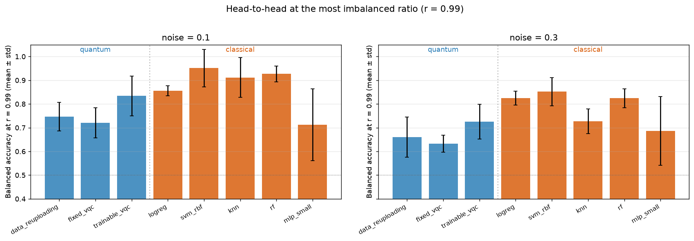

# Design of an Evaluation Framework for Hybrid Quantum-Classical Machine Learning

Master's Thesis (TFM) project. Designs and implements a modular evaluation
framework for Variational Quantum Circuit (VQC) classifiers and exercises
it on two case studies, mirroring the thesis structure: **Case Study I**
(Chapter 4) validates the framework against a published reference and
compares two gradient-estimation strategies (autodifferentiation vs
parameter-shift); **Case Study II** (Chapter 5) is a pre-registered
comparison of six VQC architectures against six classical baselines
(one of them capacity-matched) under increasing class imbalance, on two `make_moons`
datasets of contrasting geometric difficulty.

**Result in brief.** On these datasets the classical baselines win. Across
the 20 (noise, ratio) settings, the pre-registered protocol certifies 627
classical-over-quantum differences and 26 quantum-over-classical ones, out
of 720 quantum-classical pairs. All 26 are on the easier dataset
(`noise = 0.1`), against logistic regression, the linear SVM and the small
MLP, and none survives at the two most imbalanced ratios. No quantum
architecture is certified better than the RBF SVM, kNN or random forest in
any setting. `python code/case2_numbers.py` prints these counts from the
archived grid.



*Case Study II at the most imbalanced ratio (`r = 0.99`): balanced
accuracy of the six VQC architectures and the six classical baselines,
mean ± std over 12 seeds, on both datasets.*

The full motivation, methodology, results and discussion are documented
in the accompanying Master's Thesis manuscript. This README covers the
project structure and how to reproduce its results from source.

---

## Project Structure

```
project/
├── README.md                                    # You are here
├── LICENSE                                      # MIT
├── requirements.txt                             # Python dependencies
│
└── code/                                        # Framework + case-study notebooks
    ├── qml_core.py                              # Quantum primitives + Adam + parameter-shift
    ├── qml_imbalance.py                         # Data + class weighting + models + runner
    │                                            # -> Run `python qml_imbalance.py` for Case II grid
    ├── toy_datasets.py                          # 4 extra geometric datasets (make_moons-compatible)
    │
    ├── VQC_Autodiff_and_ParameterShift.ipynb    # Case Study I  (thesis Ch. 4)
    ├── imbalance_experiments.ipynb              # Case Study II (thesis Ch. 5)
    │
    ├── case2_numbers.py                         # Prints every number the thesis quotes, from the grid
    ├── case2_tables.py                          # Quantum/classical advantage tables
    ├── case2_ablation.py                        # class-weight x threshold-tuning ablation
    ├── case2_rescale_ablation.py                # What the shared feature rescaling is worth, in BA
    ├── case2_rescale_counterfactual.py          # ...and in certified wins (29 -> 26)
    ├── case2_degradation_figures.py             # Degradation curves
    ├── case2_confusion_figures.py               # Confusion matrices at the extreme ratio
    ├── case2_remaining_figures.py               # Head-to-head, AUC degradation, training sets
    ├── case2_roc_curves.py                      # ROC curves at the extreme ratios
    ├── ps_gradient_check.py                     # Parameter-shift vs finite differences (all 80 angles)
    ├── degeneracy_check.py                      # Does the BA < 0.55 flag catch constant predictors?
    ├── make_manifest.py                         # SHA-256 manifest of the archived result artefacts
    ├── compare_grids.py                         # Semantic diff of two grids (ignores fit_time_s, row order)
    │
    ├── results/
    │   ├── MANIFEST.sha256                      # Checksums of everything the thesis quotes from
    │   ├── case1_validation.json                # Accuracy sweep for Case Study I validation
    │   ├── ps_gradient_check.json               # Gradient validation output
    │   ├── case2_ablation.json                  # Ablation cell means
    │   ├── case2_rescale_ablation.json          # Both rescaling arms, per run
    │   ├── case2_rescale_counterfactual.json    # Certified-win counts under both conventions
    │   └── case2_grid.json                      # 2,880 runs from Case Study II grid
    │
    ├── figures/                                 # Figures generated by the scripts above (for thesis)
    │
    └── annex_datasets/                          # Annex C: Case Study II grid re-run on 4 toy datasets
        ├── run_annex.py                         # Full-grid runner (corners, circles, spiral, sinus)
        ├── annex_tables.py                      # Advantage and BA tables across the four datasets
        ├── annex_figures.py                     # Cross-dataset degradation and head-to-head panels
        ├── annex_detail.py                      # Per-dataset breakdown behind the annex text
        ├── quantum_geometry_summary.py          # Which geometry suits which architecture
        ├── annex_<dataset>.ipynb                # Per-dataset replica of Case Study II notebook
        ├── summary.ipynb                        # Four datasets side by side
        └── results/, figures/                   # Cached runs + generated figures
```


---

## Design at a glance

The framework is built around five principles (see Section 3.2 of the
thesis):

1. **Modularity** — six independent modules (data, circuit, training,
   class weighting, inference, runner) with explicit contracts.
2. **Reproducibility** — every random source keyed on `(seed, ratio)`;
   bit-identical results across parallel/sequential execution.
3. **Uniform interface** — `QuantumModel` and `ClassicalModel` both
   expose the same `fit / predict_score / eval_count` contract.
4. **Fixed imbalance-handling strategy** — `class_weight = "balanced"`,
   applied identically to every model that accepts sample weights.
   `KNeighborsClassifier` does not, so kNN is fitted unweighted and the
   framework records a per-run flag saying so, rather than falling back
   silently. Holding the handler fixed removes a confound that would
   otherwise make the quantum-vs-classical comparison difficult to
   interpret.
5. **Dependency-light core** — pure NumPy quantum forward; Qibo+PyTorch
   only on the autodiff path.

The evaluation protocol is built around one primary metric and one
statistical pipeline:

* **Balanced accuracy** — the single primary metric of the thesis.
* **Friedman → Wilcoxon → Holm** — paired non-parametric protocol per
  `(noise, ratio)`. With 12 models (66 pairs) and 12 seeds, the smallest
  attainable Holm-adjusted p-value is `66 × 2 / 2¹² ≈ 0.0322`, below
  `α = 0.05`.

---

## Quick start

### 1. Python interpreter

The framework was developed and tested against **CPython 3.12**.

```bash
python3 --version   # should report Python 3.12.x
```

### 2. Install dependencies

```bash
pip install -r requirements.txt          # compatible ranges, for development
pip install -r requirements-reference.txt  # exact pins, to reproduce the thesis
```

Use `requirements.txt` to work on the framework. Use
`requirements-reference.txt` when the goal is to regenerate the published
numbers bit-for-bit: it pins every dependency of both case studies to the
versions used on CPython 3.12.10 (Windows 11 x86-64, scipy-openblas).
The pins matter for the classical arm, because `MLPClassifier` gained
sample-weight support only recently and would otherwise train unweighted.

The framework's parameter-shift path (Case Study II) only needs NumPy,
scikit-learn, scipy and joblib; Qibo and PyTorch are required only by
the autodifferentiation path of Case Study I.

### 3. Reproduce Case Study I (thesis Chapter 4)

Case Study I has two parts, both inside one notebook:

```bash
cd code/
jupyter lab VQC_Autodiff_and_ParameterShift.ipynb
```

**(a) Autodiff vs parameter-shift, plus Bloch diagnostics.** Run all
cells top to bottom (~45 min: it trains all six architectures under the
multi-seed protocol). It is self-contained, uses `make_moons(noise=0.1)`
directly, and writes its figures into `code/figures/`.

**(b) Validation against a published reference.** The validation section
of the same notebook reproduces the test accuracy of a data-reuploading
VQC on the `corners` and `circles` datasets of Rodriguez-Grasa, Ban &
Sanz (arXiv:2401.04642) as a function of layers and qubits, next to that
paper's published numbers — the comparison that justifies the 2-qubit /
few-layer choice carried into Case Study II. The (qubits × layers) sweep
lives in a cache-guarded cell: with `results/case1_validation.json`
present it is skipped and the cached sweep is rendered; delete the JSON
(or set `FORCE_RESWEEP = True`) to recompute it from scratch (~1 h of
CPU).

### 4. Reproduce Case Study II (thesis Chapter 5)

The full grid is **2,880 runs**: 12 models (6 quantum + 6 classical) ×
10 ratios × 12 seeds × 2 noise levels — about two CPU-hours in total. The
grid driver is the executable entry point of the experiment library
itself; it parallelises over cores with joblib and checkpoints to
`results/case2_grid.json`, so you can interrupt and resume:

```bash
cd code/
python3 qml_imbalance.py
```

**Note that this repository ships the completed grid.** Because the driver
resumes from `results/case2_grid.json` and skips every
`(noise, model, ratio, seed)` tuple already present, the command above will
report `All tasks done; nothing to do.` and exit without computing anything.
That is the intended behaviour for regenerating figures from the archived
results. To actually re-run the experiment from scratch, write to a fresh
path so the reference artefact is not overwritten:

```bash
cd code/
N_JOBS=-1 python3 -c "from qml_imbalance import run_grid; \
    run_grid(out_path='results/case2_grid_reproduced.json')"

# Point the analysis at what you just produced, not at the archived grid.
python3 case2_numbers.py --grid results/case2_grid_reproduced.json
python3 case2_numbers.py --grid results/case2_grid.json      # for comparison
```

Every analysis script takes `--grid PATH` (or reads `CASE2_GRID`) and
defaults to the archived grid when neither is given.

`N_JOBS` sets the joblib worker count (default `1`, sequential). Results are
bit-identical regardless of it, since every random source is keyed on
`(seed, ratio)`; only the recorded `fit_time_s` values depend on it.

Once the grid is complete, open `imbalance_experiments.ipynb` in JupyterLab
and run all cells: the notebook re-uses the `results/case2_grid.json`
cache, regenerates every Case-Study-II figure into `code/figures/`, and runs
the full pre-registered statistical analysis (Friedman + Wilcoxon + Holm,
on balanced accuracy and on the ROC-AUC control) plus the ablations. The
test-set ROC panel needs per-sample scores that the cache does not store,
so its cell is guarded: it recomputes (~30 min) only when
`figures/case2-roc-curves.png` is missing, and just displays the cached
figure otherwise.

### 5. Reproduce the dataset-robustness annex (Annex C)

`code/annex_datasets/` re-runs the **identical** Case Study II grid on
four extra geometric datasets (`corners`, `circles`, `spiral`, `sinus`)
to test whether the conclusion transfers off `make_moons`. The folder
has its own README; in short:

```bash
cd code/annex_datasets/
N_JOBS=12 python3 run_annex.py     # ~25-40 min on 12-16 cores; checkpointed
jupyter lab summary.ipynb          # cross-dataset figures + advantage table
```

---

## Reproducibility guarantees

* Every random source in `qml_core.py` and `qml_imbalance.py` is keyed
  on an explicit seed. The same `(model, ratio, seed)` tuple at a fixed
  noise level produces a bit-identical result regardless of execution
  order or backend.
* The classical baselines wrap scikit-learn estimators with
  `random_state=seed`, so they are deterministic too.
* The pre-registered Case Study II grid uses **12 seeds** specifically
  so that the Friedman+Wilcoxon+Holm protocol can certify pairs rather
  than being capped by the discrete Wilcoxon distribution at the seed
  count.
* `code/results/MANIFEST.sha256` records the SHA-256 of every archived
  result artefact that the thesis reports numbers from:

  ```bash
  sha256sum -c code/results/MANIFEST.sha256
  ```

  **This checks file integrity, not reproduction.** The JSON records
  include `fit_time_s` and are written in completion order, both of
  which depend on the machine and the worker count, so a correct
  re-run will produce a different hash. Use the manifest to confirm
  that the archived files are the ones the thesis used. To check a
  re-run, compare the analyses instead:

  ```bash
  python code/compare_grids.py results/case2_grid.json \
                               results/case2_grid_reproduced.json
  ```

  That compares per-`(noise, model, ratio, seed)` metrics, ignoring
  `fit_time_s` and row order. Regenerate the manifest with
  `python code/make_manifest.py` if you publish a new set of results.

---

## What the framework does, in 30 seconds

```python
from qml_imbalance import (
    QuantumModel, ClassicalModel, run_one,
    make_balanced_dataset, friedman_wilcoxon_holm,
)

# Generate two datasets of contrasting difficulty
X1, y1 = make_balanced_dataset(n_total=8000, noise=0.1, seed=42)
X3, y3 = make_balanced_dataset(n_total=8000, noise=0.3, seed=42)

# Run the same model on both, under heavy imbalance
for X, y in [(X1, y1), (X3, y3)]:
    for name in ['trainable_vqc', 'svm_rbf']:
        model = (QuantumModel(name, n_iter=200)
                 if name in QuantumModel.SPEC
                 else ClassicalModel(name))
        result = run_one(model, ratio=0.99, seed=0,
                         X_base=X, y_base=y)
        print(f'{name:<16} BA={result.metrics["balanced_accuracy"]:.3f}')

# The friedman_wilcoxon_holm helper consumes a list of RunResults and
# returns the pre-registered statistical result per imbalance ratio.
```

The point of the uniform `(QuantumModel | ClassicalModel) → run_one`
interface is that any quantum-vs-classical comparison reduces to running
the same loop over both. See Chapter 3 of the thesis for the full design.

---

## How to cite

If this framework is useful in your work, please cite the underlying
Master's Thesis (BibTeX entry after defence date):

```bibtex
@mastersthesis{oriola2026qml,
  author = {Oriola D{\'i}az, Sergio},
  title  = {Design of an Evaluation Framework for Hybrid
            Quantum-Classical Machine Learning},
  school = {Universidad Polit{\'e}cnica de Madrid,
            ETSI de Telecomunicaci{\'o}n},
  year   = {2026},
}
```

---

## License

This project is released under the MIT License — see `LICENSE` for the
full text. All upstream dependencies are under permissive licences
(BSD-3-Clause, Apache-2.0, MIT, PSF), a point the economic-impact
analysis of ANNEX A of the thesis relies on, so the project as a whole
is freely reusable and modifiable.
